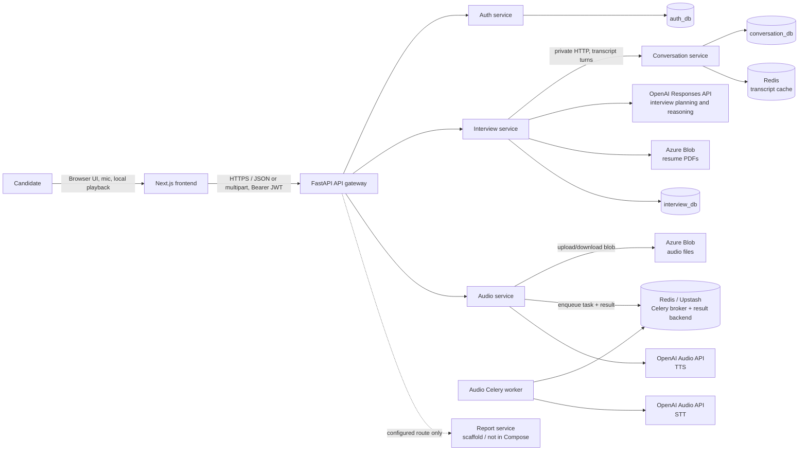
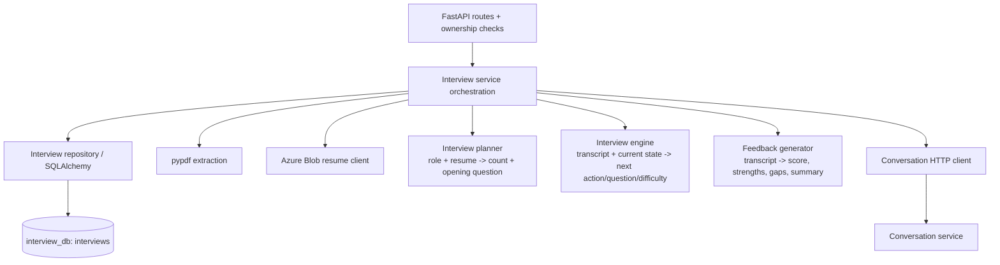
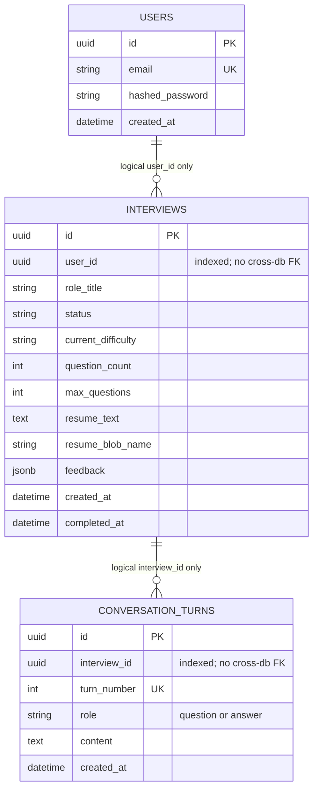

# High-Level Design (HLD)

## 1. Product and system boundary

Rizzume lets a signed-in candidate upload a text-based PDF resume, choose a target role, speak answers to generated interview questions, review/edit the recognized text, and receive structured feedback when the interview completes.



### Components and responsibility

| Component | Responsibility | Owns / calls |
|---|---|---|
| Next.js frontend | Auth screens, interview UI, mic recording, transcript review, question audio playback, local camera preview | Calls only gateway; browser MediaRecorder / getUserMedia / Audio |
| API gateway | Public API boundary, CORS, JWT signature/expiry verification, route forwarding, trusted user identity propagation | Forwards HTTP to service containers |
| Auth service | Signup, login, refresh, current-user lookup; bcrypt and JWT issuance | `auth_db` |
| Interview service | Resume handling, interview state machine, LLM orchestration, completion feedback | `interview_db`; calls conversation service, OpenAI, Azure Blob |
| Conversation service | Durable ordered question/answer transcript and short-lived read cache | `conversation_db`, Redis cache |
| Audio service | Upload audio for asynchronous transcription; synchronous speech synthesis | Azure Blob, Celery/Redis, OpenAI Audio |
| Audio worker | Downloads uploaded audio and runs STT outside the HTTP request | Celery queue `audio_tasks`, Azure Blob, OpenAI Audio |
| Report service | Intended standalone report/PDF generation | Has scaffolding and ping task only; not in local Compose or live interview flow |

## 2. Runtime topology

`infra/docker-compose.yml` runs the frontend, gateway, auth, interview, conversation, audio API, and audio worker. Containers call one another by Compose DNS name on the Compose network. The databases, Redis and Azure Blob are hosted services supplied by per-service `.env` files; Compose does not start local Postgres, Redis, or object storage. Host-facing ports are frontend `3000`, gateway `18000`, and direct-debug service ports `18001`–`18004`.

The gateway is the browser's only backend entry point. Its routes strip `/api/v1/{service}` and proxy the rest of the path. `interview-service` calls `conversation-service` directly over internal HTTP; that internal call does not go back through the gateway. Each service owns its own database. There are no cross-database foreign keys or direct cross-service SQL reads.

## 3. Authentication and trust flow

```mermaid
sequenceDiagram
    actor U as Candidate
    participant FE as Frontend
    participant GW as API gateway
    participant A as Auth service
    participant DB as auth_db
    U->>FE: Signup or login (email + password)
    FE->>GW: POST /api/v1/auth/signup or /login
    GW->>A: Proxy public auth request
    A->>DB: Find/create user; verify bcrypt hash
    A-->>GW: access_token + refresh_token (JWT)
    GW-->>FE: Token response
    FE->>FE: Store both tokens in localStorage
    FE->>GW: Protected call + Authorization: Bearer access_token
    GW->>GW: Verify signature/expiry; read sub
    GW->>A: Proxy request and add X-User-Id
    Note over GW,A: Auth-service protected /me consumes X-User-Id. Other internal services trust this gateway-provided identity.
```

The gateway and auth service must share the JWT signing secret and algorithm. JWTs carry `sub`, `type`, `iat`, and `exp`. The refresh endpoint explicitly checks for a `refresh` type, so an access token cannot be used there; the gateway middleware currently verifies signature/expiry and reads `sub` but does not check that `type` is `access`. The refresh-token implementation is stateless: no server-side revocation list is present. Frontend token storage is localStorage. Treat the browser-to-gateway and gateway-to-service boundary as security-critical; downstream identity headers are trusted only because services are intended to be private behind the gateway.

## 4. Main user flow: resume to first question

```mermaid
sequenceDiagram
    actor U as Candidate
    participant FE as Frontend
    participant GW as Gateway
    participant I as Interview service
    participant A as Audio service
    participant B as Azure Blob (resumes)
    participant L as OpenAI Responses API
    participant C as Conversation service
    participant DB as interview_db / conversation_db
    participant OA as OpenAI Audio API
    U->>FE: Select PDF and enter role
    FE->>GW: POST /api/v1/interviews/ (multipart PDF + role_title, JWT)
    GW->>GW: Verify JWT; derive user_id
    GW->>I: POST / (X-User-Id + multipart body)
    I->>I: Validate PDF type/non-empty; extract text with pypdf
    I->>B: Store original PDF under generated blob name
    I->>L: plan_interview(resume, role)
    L-->>I: Structured question_count, remark, first question
    I->>DB: Create interview (resume text + blob reference + plan)
    I->>C: POST /interviews/{id}/turns (first question only)
    C->>DB: Persist ordered turn
    I->>DB: Advance question count
    I-->>GW: Interview + opening remark + question
    GW-->>FE: JSON response
    FE->>GW: POST /api/v1/audio/speech {text: remark + question}
    GW->>A: Proxy to audio-service
    A->>OA: gpt-4o-mini-tts
    A-->>GW: audio/mpeg bytes
    GW-->>FE: audio/mpeg bytes
    FE->>U: Play opening question audio
```

The first-question creation call is synchronous and may wait on PDF extraction, Blob Storage, the LLM, and cross-service/database writes. The planner's structured output constrains the planned count to configured min/max bounds; code also clamps it defensively.

## 5. Main voice turn: answer to next question

```mermaid
sequenceDiagram
    actor U as Candidate
    participant FE as Browser
    participant GW as Gateway
    participant A as Audio service
    participant R as Redis/Celery
    participant W as Audio worker
    participant O as OpenAI Audio API
    participant B as Azure Blob (audio)
    participant I as Interview service
    participant C as Conversation service
    participant DB as Postgres databases
    U->>FE: Press record; answer aloud
    FE->>FE: getUserMedia + MediaRecorder collects chunks
    U->>FE: Press stop
    FE->>GW: POST /api/v1/audio/transcriptions (multipart audio)
    GW->>A: Proxy request
    A->>B: Upload audio bytes; generate blob name
    A->>R: Enqueue transcribe(blob_name)
    A-->>FE: 202 {job_id, status: pending}
    loop about every 1.5s, up to 60s
        FE->>GW: GET /api/v1/audio/transcriptions/{job_id}
        GW->>A: Proxy status request
        A->>R: Read Celery result state
        A-->>FE: pending / started / completed + transcript / failed
    end
    W->>R: Consume audio_tasks job
    W->>B: Download audio by blob name
    W->>O: gpt-4o-mini-transcribe
    W->>R: Store transcript as task result
    FE->>U: Display editable transcript for review
    U->>FE: Edit if needed, then submit
    FE->>GW: POST /api/v1/interviews/{id}/answer {answer}
    GW->>I: Proxy with X-User-Id
    I->>C: Append answer; fetch ordered transcript
    C->>DB: Persist turn; read cache or DB, invalidate cache on write
    I->>O: Decide next step (one structured LLM call)
    alt Continue
        O-->>I: remark + question + next difficulty
        I->>C: Append clean question (remark excluded)
        I->>DB: Increment question_count, update difficulty
        I-->>FE: next question + remark
        FE->>GW: POST /api/v1/audio/speech
        GW->>A: Proxy to audio-service
        A->>O: gpt-4o-mini-tts, voice alloy
        A-->>FE: audio/mpeg bytes
        FE->>U: Play audio; animate speaking indicator
    else End
        O-->>I: End decision (or hard question-count limit)
        I->>O: Generate structured feedback from transcript
        I->>DB: Mark completed and save feedback JSON
        I-->>FE: Completed interview + feedback
    end
```

The browser's `CameraPanel` is a self-preview only. The interview camera stream is not uploaded or stored. Transcript text, not raw audio, is what the interview engine consumes and what the conversation service persists.

## 6. Interview service internal design



The three model roles are deliberately separate lifecycle steps. Question selection and difficulty adjustment are combined in one call so they agree and do not cost separate LLM round trips. Each model response uses a Pydantic schema via the OpenAI Responses API. `reasoning` is internal metadata; it is not shown to the candidate.

## 7. Data ownership and persistence



Each table is in a different service-owned database, so the relationship lines are logical identifiers, not database-enforced foreign keys. Blob names are references; containers are private and access goes through the owning service. Redis stores both Celery broker/result data and a conversation turn-list cache (shared hosted Redis, separate queue name for audio jobs).

## 8. Scope, constraints and honest status

- **Not streaming:** full answer recording, upload, async transcription, review, submit. No WebSocket, WebRTC, VAD, streaming partial transcripts, streaming TTS, barge-in, or live turn detection.
- **Not end-to-end audio-to-audio:** STT, LLM reasoning and TTS are distinct stages and model/API calls.
- **Report service is not active:** Compose omits it; its current worker has only `report.ping`; the interview service generates and stores feedback itself. Gateway has a report proxy route configured, but that does not make report generation operational.
- **Auth is custom and MVP-simple:** JWT access and refresh tokens; refresh is stateless and frontend keeps tokens in localStorage.
- **External dependencies:** Postgres, Redis, Azure Blob, and OpenAI are external to local Compose and configured through service environment files.
- **Failure boundaries:** audio upload can fail before enqueue; worker/STT can fail after `202`; browser polling has a 60-second timeout; internal HTTP and LLM/storage calls can fail. The code has basic HTTP errors but no general retry/idempotency/outbox scheme.
- **Transcript durability:** conversation writes are committed before response; Redis is a cache and can be repopulated from Postgres. No transactional commit spans interview_db, conversation_db, Blob Storage, or OpenAI.

## 9. Interview-ready architecture summary

> “The browser talks only to a FastAPI gateway. The gateway validates JWTs once and forwards the authenticated user ID to private services. The interview service owns interview state and calls an OpenAI-backed engine; transcript data is owned by a separate conversation service and reached over HTTP. Voice input is record-and-upload: audio is stored in Azure Blob, a Celery task on Redis runs OpenAI transcription, and the UI polls for the result. After transcript review, the interview service chooses the next turn and the audio service synchronously returns generated question audio. Each domain service owns its own Postgres database. Reporting is planned but not currently wired into the running flow.”
