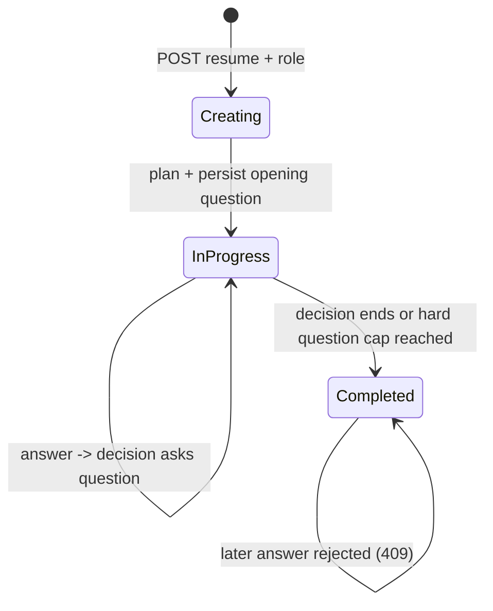

# Low-Level Design (LLD)

This document follows the implementation from HTTP route to service/repository/provider and records the state and data contracts that matter when explaining or changing it.

## 1. Service boundaries and code map

| Service / area | Entry points | Main implementation |
|---|---|---|
| Frontend | `frontend/src/app`, feature components | `features/auth`, `features/interview`, `features/audio`, `lib/api-client.ts` |
| Gateway | `services/api-gateway/app/main.py` | `middleware/auth.py`, `api/endpoints/*`, `core/proxy.py`, `clients/registry.py` |
| Auth | `services/auth-service/app/main.py`, `api/auth.py` | `services/auth_service.py`, `repositories/user_repository.py`, `utils/security.py`, `models/user.py` |
| Interview | `services/interview-service/app/main.py`, `api/interviews.py` | `services/interview_service.py`, `engine/*`, `clients/conversation_client.py`, `storage/blob_client.py`, `utils/pdf_extractor.py`, `models/interview.py` |
| Conversation | `services/conversation-service/app/main.py`, `api/transcripts.py` | `services/transcript_service.py`, `repositories/transcript_repository.py`, `repositories/session_cache.py`, `models/transcript.py` |
| Audio API | `services/audio-service/app/main.py`, `api/transcriptions.py`, `api/speech.py` | `worker/tasks.py`, `worker/celery_app.py`, `providers/openai_stt.py`, `providers/openai_tts.py`, `storage/blob_client.py` |
| Report | `services/report-service/app/main.py` | Currently health route + `report.ping` worker task; report domain implementation is not present |

Every service has independent dependency metadata, config, logging, Dockerfile and database setup. Frontend request/response TypeScript interfaces are maintained manually and intentionally mirror Python Pydantic schemas; there is no generated/shared contract package.

## 2. Gateway routing and auth details

The frontend URL prefix determines the gateway endpoint module:

| Public path prefix | Upstream | Internal path example |
|---|---|---|
| `/api/v1/auth/{path}` | auth-service | `/login`, `/me` |
| `/api/v1/interviews/{path}` | interview-service | `/`, `/{uuid}`, `/{uuid}/answer` |
| `/api/v1/audio/{path}` | audio-service | `/transcriptions`, `/speech` |
| `/api/v1/reports/{path}` | report-service config exists | Not active in Compose |

For non-public requests, `JWTAuthMiddleware` requires `Authorization: Bearer ...`, decodes using the configured algorithm and secret, and places the `sub` claim in `request.state.user_id`. `proxy_request` copies request headers (minus `Host`), adds `X-User-Id`, forwards method/query/body using a shared `httpx.AsyncClient`, and relays the upstream body/status while stripping connection-specific headers. CORS wraps the auth middleware so early 401s still carry CORS headers. Health and `OPTIONS` bypass JWT.

The gateway authenticates only at the edge. The auth service's protected `/me` consumes the injected identity header. Interview service also reads `X-User-Id` via its dependency and enforces ownership by comparing it to the interview row's `user_id`. Conversation and audio are intended as private internal services; they do not independently authenticate the caller.

Auth endpoints: `POST /api/v1/auth/signup`, `POST /login`, `POST /refresh` are public; `GET /me` is protected. Signup hashes passwords with bcrypt; login checks bcrypt; access and refresh tokens are signed JWTs with distinct `type` claims and expiry. Frontend stores both tokens in localStorage, attaches access token to API requests, and calls refresh explicitly through its API helper (no automatic refresh/retry interceptor is present in `api-client.ts`).

## 3. HTTP API contracts and path

### Interview creation

- `POST /api/v1/interviews/` (trailing slash is the direct route; without it FastAPI may issue a 307 redirect).
- Authenticated multipart fields: `resume` (PDF file), `role_title` (form string).
- Response `201`: `{ interview, remark, question }`.
- Validation: content type must be `application/pdf`, bytes must be non-empty, and PDF extraction must produce text. Scanned image-only PDFs are rejected as having no extractable text.
- Service then stores original PDF in private `rizzume-resumes`, calls the planner, saves an interview row, appends opening question to conversation service, advances the interview counter, and returns the remark/question. The remark is spoken/displayed but not persisted as a transcript turn.

### Audio input: asynchronous transcription

- `POST /api/v1/audio/transcriptions` multipart field `file`; response `202 { job_id, status: "pending" }`.
- Audio API reads upload bytes, writes private blob named `{uuid}-{filename}`, then queues Celery task with only that blob name. Audio bytes do not travel through Redis.
- `GET /api/v1/audio/transcriptions/{job_id}` returns `{ job_id, status, transcript }`. Celery `PENDING` maps to `pending`, `STARTED` to `started`, `SUCCESS` to `completed`, `FAILURE` to `failed`.
- Worker downloads blob and calls `gpt-4o-mini-transcribe`, with file extension provided to the SDK for format detection. Result text is kept in Celery's configured result backend.
- Browser polls every 1500 ms, with a 60-second deadline. On completion the user can edit/re-record before submit.

### Audio output: synchronous speech generation

- `POST /api/v1/audio/speech` JSON `{ text }`.
- Audio service calls `gpt-4o-mini-tts`, voice `alloy`, format MP3 and returns raw `audio/mpeg` bytes.
- Browser receives a Blob, creates an object URL and plays it with an `HTMLAudioElement`. The avatar's simple `isSpeaking` indicator follows playback events. This is not lip sync.

### Answer submission and interview read

- `POST /api/v1/interviews/{interview_id}/answer` JSON `{ answer }` returns `{ interview, remark, question, feedback }`.
- Interview service loads the interview and checks ownership/status. It appends the answer, fetches ordered transcript, calls `decide_next_step`, and either persists the next clean question + updated state or creates feedback + marks completed.
- `GET /api/v1/interviews/{uuid}` returns the owned interview row. UUID route converter prevents arbitrary string routes from matching.
- No frontend transcript-read endpoint or list-past-interviews endpoint is implemented. Conversation routes are internal to interview-service orchestration.

## 4. End-to-end backend orchestration

### `start_interview`

1. Route validates content type and reads uploaded bytes.
2. `extract_text` uses `pypdf.PdfReader`; it joins page text and rejects empty extraction.
3. Interview service creates UUID blob name and uploads original PDF to Azure.
4. `interview_planner.plan_interview` sends role + resume text to `gpt-5.4-mini` via `client.responses.parse` and `InterviewPlan` schema.
5. Planner returns bounded `question_count`, greeting `remark`, opening `question`, and internal `reasoning`.
6. Repository inserts `Interview` with `in_progress`, initial difficulty `medium`, resume text/blob reference and planned count.
7. Conversation client POSTs the opening question. Conversation service commits it as turn 1 and invalidates any cached list.
8. Interview repository `advance` increments question count and stores difficulty.
9. Route returns public interview fields plus remark/question.

### `submit_answer`

1. Service fetches interview by UUID, 404s if absent/not owned, and rejects completed interview with 409.
2. Append answer to conversation service; then GET complete transcript ordered by turn number.
3. `interview_engine.decide_next_step` calls `gpt-5.4-mini` with role, resume, transcript, current difficulty, count and max count. Structured output gives `action`, optional remark/question/difficulty and internal reasoning.
4. End if model returns `end_interview` **or** the already-asked question count has reached this interview's `max_questions`.
5. End branch calls feedback generator with role + transcript; its structured schema is score 0–100, strengths, improvement areas and summary. Save JSONB feedback and mark interview complete with timestamp.
6. Continue branch chooses returned question or a defensive fallback. Append only the clean question (no remark) to transcript. Advance question count and set chosen/fallback difficulty.
7. Return interview plus either next remark/question or feedback. Frontend plays next speech or shows completed result.

Question count counts questions asked, not answer count. The planner sets interview-specific `max_questions` within constants' bounds. LLM instructions ask the model to stop at the plan, and service code also enforces the limit.

## 5. Interview state machine

Per-answer browser state:

```mermaid
stateDiagram-v2
    [*] --> Idle
    Idle --> Recording: microphone permission + MediaRecorder.start
    Recording --> Transcribing: stop recorder; upload audio
    Transcribing --> Reviewing: poll returns completed transcript
    Transcribing --> Idle: error/failure/timeout; allow retry
    Reviewing --> Idle: re-record
    Reviewing --> Submitting: submit transcript text
    Submitting --> Idle: next question returned
    Submitting --> Completed: feedback returned
    Submitting --> Reviewing: submit/API error
```

Early end from the UI navigates away and stops playback, but does not call a backend completion endpoint; it therefore does not mark the record completed or generate feedback.

## 6. Data schemas and ownership

| Storage | Shape / key | Purpose | Truth or cache? |
|---|---|---|---|
| `auth_db.users` | UUID, unique indexed email, bcrypt hash, created timestamp | Credentials and account identity | Durable source of truth |
| `interview_db.interviews` | UUID, indexed `user_id`, role, status, difficulty, question/max counts, resume text/blob name, feedback JSONB, timestamps | Session state and final feedback | Durable source of truth |
| `conversation_db.conversation_turns` | UUID, `interview_id`, unique `(interview_id, turn_number)`, role, content, timestamp | Ordered transcript (`question` or `answer`) | Durable source of truth |
| Redis transcript cache | `session:{interview_id}:turns`, JSON, 2-hour TTL | Avoid repeated Postgres transcript reads | Rebuildable cache |
| Redis Celery broker/backend | Audio task message includes blob name; result keyed by job ID | Queue work and expose status/transcript result | Operational task state/result |
| Azure `rizzume-resumes` | Original PDF blob under generated UUID | Source resume file | Durable object |
| Azure audio container | Original audio blob under generated UUID + filename | Temporary/retained task input (no cleanup shown) | Durable object unless externally cleaned |

The transcript repository commits each append before returning. Cache reads return a cached ordered list when present; writes invalidate rather than edit the cached list. There is no SQL transaction spanning interview DB and conversation DB. In particular, an interview row can be created while appending its initial transcript fails, and an answer can be persisted even if later LLM generation fails; there is no outbox/saga compensation in the current implementation.

## 7. Interview engine prompt contracts

| Engine module | Called when | Input context | Structured response |
|---|---|---|---|
| `interview_planner.py` | Start | Role + extracted resume | question count (bounded), greeting, opening question, reasoning |
| `interview_engine.py` | Every submitted answer | Role + resume in instructions; transcript + current difficulty + question counts | ask/end, short remark, next question, next difficulty, reasoning |
| `feedback_generator.py` | Completion only | Role + full transcript | integer score, strengths list, improvement list, summary |

All use `gpt-5.4-mini` and OpenAI Responses `parse` into Pydantic models. The engine is an internal module in interview-service, not a separate network service. No speech emotion recognition, speaker diarization, word-level timestamps, embeddings, RAG/vector database, or dedicated evaluation model appears in this code path.

## 8. Infrastructure and startup

- Each service uses FastAPI/Uvicorn, its own `pyproject.toml`/`uv.lock`, Dockerfile, settings and logging.
- DB-backed services use SQLAlchemy async sessions and Alembic migrations. Auth, interview, and conversation each have separate DB names/config.
- Compose injects internal service URLs for gateway and interview-to-conversation calls; hosted DB/Redis/Blob credentials come from ignored per-service `.env` files generated by `scripts/bootstrap-env.sh`.
- Audio API and audio worker are separate Compose processes built from the same image/settings. Worker runs Celery app `app.worker.celery_app`.
- Audio queue is explicitly `audio_tasks`; this matters because hosted Upstash supports Redis DB 0 only, and queue naming isolates audio jobs from a future report worker sharing the Redis endpoint.
- Compose `depends_on` expresses startup order, not application readiness. There is no local data-store container or health-based readiness dependency.

## 9. Error and reliability behavior

- Gateway missing/invalid token: 401; CORS middleware is outside JWT middleware so the browser can read the response.
- Signup duplicate: 409; invalid login/refresh: 401.
- Start interview invalid MIME/empty file/no extracted PDF text: 400.
- Interview missing or not owned: both become 404 to avoid revealing another user's interview. Completed interview answer: 409.
- Audio empty upload: 400. A task `FAILURE` surfaces as transcription `failed`; polling deadline is 60 seconds. `PENDING` also means unknown task ID, so status cannot distinguish a typo from queued-but-not-started.
- The gateway uses reusable async HTTP clients with timeouts (auth 10s, interview 30s, audio 60s, report 30s); interview-to-conversation timeout is 10s.
- No universal retry policy, idempotency key, rate limiting, distributed tracing, task retry/backoff policy, transcript retention policy, or blob cleanup process is evident in these paths.

## 10. Interview discussion: tradeoffs and next steps

**Why separate STT and TTS from interview reasoning?** Their workloads differ: answer audio transcription can be slow and uses a queue, while short question synthesis is returned inline for immediate playback; interview reasoning remains a text-centric structured LLM call. The chosen record-and-upload UX accepts turn latency and supports transcript correction.

**Why queue transcription?** It keeps an HTTP request from waiting on audio processing and gives the browser a job ID/status lifecycle. The tradeoff is polling overhead, eventual completion, task-result retention concerns and more moving parts (Redis + worker + Blob).

**Why durable transcript plus cache?** Postgres provides ordered history and recovery; Redis avoids repeated reads while generating context. Cache invalidation on append keeps one simple source of truth.

**What would change for real-time conversation?** This current architecture is not enough. Add a streaming transport (typically WebRTC for browser media or WebSocket for events/audio), streaming ASR/TTS or a realtime speech model, VAD/endpointing, turn cancellation/barge-in, partial transcript events, backpressure, reconnect semantics, session affinity/state, and latency/quality telemetry. Reevaluate whether gateway can proxy the chosen bidirectional media protocol or use a media gateway. This is an architectural extension, not a configuration switch.

**Reliability improvement candidates:** make interview start and answer processing idempotent; define cross-service failure recovery (outbox or explicit saga); add bounded Celery retry/backoff and expiration/cleanup for audio blobs/results; persist task/job ownership; use event-based completion instead of tight polling if scale needs it; add rate limits, request size limits and structured trace IDs; consider signed short-lived upload URLs for large audio while retaining service validation.
