# Voice AI concepts in Rizzume

This guide defines the voice concepts in practical terms and maps each one to the implementation. It separates what is built from capabilities that are often mentioned in “voice AI” interviews but are not present here.

## 1. The voice loop in one picture

```mermaid
flowchart LR
    Q[Interviewer text: remark + question] -->|Text-to-speech| TTS[OpenAI TTS\ngpt-4o-mini-tts / alloy]
    TTS -->|MP3 over HTTP| PLAY[Browser audio playback]
    PLAY --> CANDIDATE[Candidate listens]
    CANDIDATE -->|Microphone| MIC[MediaRecorder\nfull answer chunks]
    MIC -->|WebM blob upload| BLOB[Azure Blob]
    BLOB -->|Celery job: blob name| WORKER[Audio worker]
    WORKER -->|Audio bytes| STT[OpenAI STT\ngpt-4o-mini-transcribe]
    STT -->|Transcript text| REVIEW[Candidate reviews/edits]
    REVIEW -->|Text answer| ENGINE[Interview engine\ngpt-5.4-mini]
    ENGINE -->|Next question + remark| Q
```

This is a **cascaded voice architecture**: ASR/STT → text LLM → TTS. Audio does not go directly into the interview reasoning model, and the model does not stream a spoken response. It is also **turn-based**: the app waits for the candidate to stop recording and waits for a transcription result before submitting that turn.

## 2. Glossary and code mapping

| Concept | Plain-language meaning | In this project |
|---|---|---|
| Speech-to-text (STT) / automatic speech recognition (ASR) | Convert recorded speech into text | `openai_stt.transcribe`, `gpt-4o-mini-transcribe`, Celery worker |
| Text-to-speech (TTS) | Produce speech audio from text | `openai_tts.synthesize`, `gpt-4o-mini-tts`, voice `alloy`, MP3 response |
| Cascaded pipeline | Independent STT, language model and TTS stages connected in sequence | Exactly the answer → transcript → interview decision → spoken question loop |
| Turn-based interaction | One speaker finishes a complete turn before the system responds | MediaRecorder stop → STT job → transcript review → submit → next response |
| Batch/record-and-upload audio | Send an audio file after recording ends, not a live stream | Browser uploads one Blob per answer to `/audio/transcriptions` |
| Job queue | Run slow work outside the request/response call | Celery task `audio.transcribe` on Redis queue `audio_tasks` |
| Broker | Delivers queued work to workers | Redis/Upstash configured as Celery broker |
| Result backend | Stores task state and result for clients to query | Redis/Upstash; transcript returned by polling task ID |
| Object storage | Store binary files outside a relational database | Private Azure Blob containers for resume and audio |
| Polling | Client asks periodically whether async work finished | Browser queries status every 1.5s for up to 60s |
| Structured output | LLM result constrained to a schema rather than free-form prose | OpenAI Responses `parse` into Pydantic plan/decision/feedback models |
| Prompt orchestration | Application chooses context/instructions and calls model(s) | Interview planner, decision engine and feedback generator |
| Transcript | Ordered textual record of the exchange | `conversation_db.conversation_turns`, question/answer roles |
| Endpointing / end-of-turn detection | Determine when the speaker has finished | Not automatic; the user presses Stop |
| Voice activity detection (VAD) | Detect speech vs silence/noise | Not implemented |
| Streaming ASR | Produce partial/final text while person is speaking | Not implemented; STT runs after upload |
| Streaming TTS | Start playback before complete audio is generated | Not implemented; full MP3 returned in one response |
| Barge-in | Let a user interrupt the system while it speaks and stop output | No integrated barge-in logic; UI has a stop helper for explicit navigation |
| Diarization | Identify which speaker said each segment | Not needed for single candidate turns; not implemented |
| Emotion/prosody analysis | Infer affect or delivery from acoustic features | Not implemented; feedback sees transcript text |
| Realtime speech model | A model/API that can take and produce audio in a continuous session | Not used; separate STT/TTS APIs are used |

## 3. Audio input, step by step

1. Browser calls `getUserMedia({ audio: true })` after user action, creates a `MediaRecorder`, accumulates non-empty `dataavailable` chunks and stops microphone tracks when recording ends.
2. Chunks are combined into a browser `Blob` (normally WebM; filename defaults to `answer.webm`). The browser sends multipart form data. It deliberately lets `fetch` set the multipart boundary.
3. Gateway verifies access JWT and proxies the upload to audio-service. The audio API reads the complete upload into memory, rejects empty bytes, uploads the file to Azure Blob and queues a Celery task with the blob name.
4. HTTP returns `202 Accepted` and a task ID without waiting for STT. Redis carries a small task argument, not the audio bytes.
5. Worker downloads the blob and sends its bytes to OpenAI transcription. The filename is attached to the in-memory file object because extension helps the API identify format.
6. Worker result backend records success + transcript or failure. Audio status route maps Celery states into the app's four status strings.
7. Browser polls. On completion the transcript is presented in an editable review stage. The candidate can re-record or correct recognition mistakes before sending text to the interview endpoint.

### Why keep audio in Blob instead of Celery?

Audio is much larger than a job message. Passing only a blob identifier keeps Redis broker traffic small and lets a worker fetch the bytes when ready. It also creates a cleanup/retention responsibility: this code has no deletion lifecycle for the uploaded object.

## 4. Audio output, step by step

1. Interview endpoint returns the next question and a short conversational remark as text.
2. Frontend combines them for speech; only the question is persisted in the transcript.
3. Frontend posts `{ text }` to audio-service through the gateway.
4. Audio-service calls the TTS API with the configured model/voice/MP3 format and returns binary `audio/mpeg` directly.
5. Browser receives a Blob, creates an object URL, constructs `Audio`, and plays it. Playback events set/clear `isSpeaking`, which drives the avatar glow/indicator. On completion/error the object URL is revoked.

This short synthesis call is synchronous by design. There is no synthesis task ID, queue, status polling, streaming chunks, generated audio persistence, or server-side playback session.

## 5. Interview reasoning is not speech recognition

The interview engine receives **text** plus structured context:

- Role title and extracted resume text
- Full ordered transcript (question and answer turns)
- Current difficulty and planned/current question counts

It uses `gpt-5.4-mini` and a Pydantic response schema to choose `ask_question` or `end_interview`, write a short spoken remark, generate a question, and set next difficulty. Follow-up choice and difficulty adaptation are one call so they stay coherent. At completion, another structured call produces feedback from the transcript. No raw audio, pitch, pace, pronunciation, emotion, or facial video is passed to these prompt functions.

The resume PDF is parsed with `pypdf`, and extracted text is stored on the interview row so later calls can use it. Original PDF is stored in Azure Blob. This is document text extraction, not embeddings/RAG: no vector store or retrieval step is present.

## 6. Latency and user experience

The answer response time is a sum of stages: upload + Blob write + queue wait + Blob read + STT + poll interval, then on submit transcript writes/reads + LLM decision + possibly next-question transcript write + TTS call + browser download/playback. Some operations are sequential. The interview start path also waits on resume extraction, Blob upload, planning LLM and service/database writes.

The queue helps the API avoid holding a transcription request open, but it does not make transcription itself faster. Polling interval controls how quickly the UI notices completion after the task ends. TTS is in the response path, so its latency affects time to playback. There is no streaming to conceal generation latency.

Practical interview phrasing: “I chose asynchronous transcription because full-turn STT can take longer and should not hold an API request open. The UI polls a job ID and gives the user a transcript correction step. Short interviewer prompts use synchronous TTS because I need the audio as the next turn begins. The tradeoff is turn latency and polling; a natural real-time conversation would need a streaming media/session architecture.”

## 7. What real-time voice would add

For a genuinely conversational voice agent, an architecture would need more than replacing model names:

- Bidirectional streaming transport such as browser WebRTC or a WebSocket event/audio channel.
- Partial ASR events and endpointing/VAD to infer end of turn without a Stop click.
- Incremental TTS audio chunks and playback buffering.
- Barge-in/cancellation so user speech interrupts generated speech and cancels in-flight work.
- Session state and ordering across partial/final transcript events, reconnects and retries.
- Backpressure and flow control for audio frames, plus codec/sample-rate handling.
- Latency budgets/telemetry across capture, network, ASR, reasoning, TTS and playback.
- Privacy and retention decisions for live audio, transcripts, recordings and model-provider data.

The current product deliberately does not implement these. Describe it as voice-enabled, turn-based interview practice rather than a real-time voice assistant.

## 8. Common interview questions and short answers

**Is this a real-time voice bot?** No. It records a complete answer, uploads it, transcribes asynchronously, shows editable text, then asks the next turn. There is no bidirectional media stream.

**Why use Celery for transcription?** It separates slow STT from request latency, returns a job ID immediately and lets a worker process uploaded audio. Redis carries references/results; Blob carries the audio. Cost: another service, polling, operational state and cleanup concerns.

**Why does TTS not use Celery?** The output is a short question needed immediately for the next turn. Returning audio inline avoids an extra job/status round trip. For longer speech or high load, queueing/streaming choices should be revisited.

**What is the source of truth for transcripts?** Conversation Postgres. Redis caches the ordered list for two hours but is invalidated on append and can be rebuilt from Postgres.

**Does the system evaluate speaking quality?** No. Feedback is generated from the text transcript. Audio prosody, pace, pronunciation, emotion and video are not analyzed.

**Where does the LLM run?** Interview orchestration runs inside interview-service and calls OpenAI. It is not a separate microservice. STT and TTS calls originate from audio-service/worker.

**What if the worker fails?** Celery exposes failure state and the client reports transcription failure. The current code does not show a customized retry/backoff policy or cleanup; the user can re-record and retry.

**What if the transcript is wrong?** It is editable before submission, which is a human-in-the-loop correction step. This improves reasoning quality and gives the candidate control.
